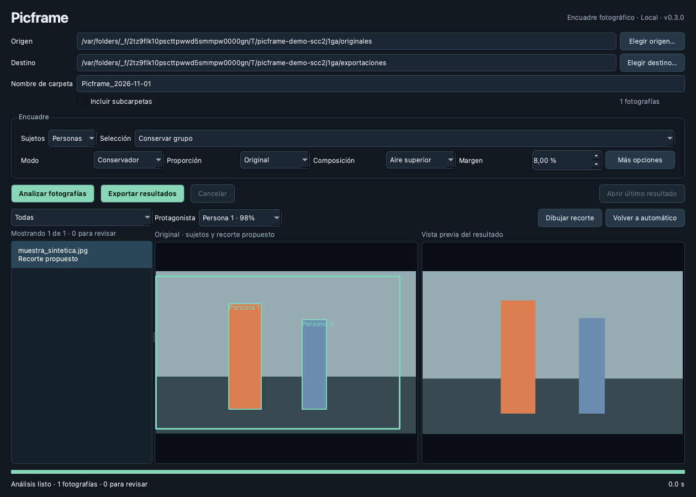

# Picframe

Aplicación local para mejorar el encuadre de fotografías JPG/JPEG en macOS Apple Silicon.
Detecta personas, animales o vehículos, selecciona un protagonista o protege un grupo y
exporta a una carpeta independiente, sin modificar originales.

## Estado actual

**Picframe 0.3.0 ya tiene interfaz de escritorio**, además del CLI.
La aplicación local está en `dist/Picframe.app`: abrir con doble clic en Finder.
Permite elegir carpetas, analizar en segundo plano, comparar original/recorte, seleccionar
otro sujeto, dibujar un recorte seguro y exportar con los metadatos verificados.

[Guía de escritorio](docs/desktop.md) · [validación](docs/desktop-validation.md)



La detección no excluye personas por espalda. Conservar grupo es una elección explícita;
Dominante mantiene las fotos inciertas en revisión hasta resolver su selección.
Metadatos estrictos, focal real, prioridad de espacio superior y límites de resolución se
comparten con el CLI. Los originales no se modifican.

El bundle local está preparado y probado en este Mac; no está notarizado para distribución.
La evaluación completa con 30–50 fotos y el lote grande de T042/T043 siguen pendientes.

## Operación desde el chat

El propietario puede indicar una carpeta y pedir al agente que la procese. No necesita usar
terminal o editor. Antes de procesar sus fotos, revisaremos juntos origen, destino y parámetros.
Los comandos siguientes son referencias reproducibles para el agente.

## Preparación del entorno

Python 3.11.16 y uv. El Mac de desarrollo ya tiene dependencias y pesos preparados.

```sh
uv sync --locked --extra detector --extra gui
uv run --no-sync python scripts/prepare_model.py
uv run --no-sync python scripts/prepare_metadata_tool.py
uv run --no-sync picframe --version
```

La preparación descarga dependencias/pesos explícitamente. El procesamiento posterior no usa
servicios externos ni descarga pesos. Véase [modelos](docs/modelos.md) y [dependencias](docs/dependencias.md).
La GUI es un extra opcional para el CLI. La suite completa de desarrollo requiere `--extra gui`
porque ahora incluye pruebas de widgets; el núcleo geométrico sigue sin importar Qt.

## Procesamiento

```sh
uv run --no-sync picframe process /ruta/entrada --output /ruta/salida --model models/yolo11n.pt
uv run --no-sync picframe process /ruta/entrada --output /ruta/salida --model models/yolo11n.pt --mode balanced --aspect 4:5 --device auto
uv run --no-sync picframe report /ruta/salida/job-UUID
uv run --no-sync picframe report /ruta/salida/job-UUID --recover
```

Cada trabajo crea un subdirectorio exclusivo `job-UUID`. Por defecto, el destino propuesto es
`Raceframe_Output` (nombre compatible del CLI), hermano de la entrada. Se rechaza destino igual a entrada o dentro de una entrada recursiva.
Sin recursión se permite una subcarpeta de salida, excluida del inventario. Dentro del trabajo, nombres repetidos reciben sufijos; nunca se sobrescriben salidas.
Los volúmenes sin publicación exclusiva mediante enlaces duros se rechazan antes de exportar.

Opciones: `--recursive`, `--mode conservative|balanced|tight`, `--aspect original|3:2|4:5`,
`--margin` (0–0,5), `--quality` (1–95), `--device cpu|mps|auto`, `--config ARCHIVO_JSON`.
Argumentos explícitos prevalecen sobre archivo y valores por defecto. Pesos y umbrales avanzados
se configuran mediante JSON y quedan en el manifiesto; consultar [plan](specs/001-reencuadre-cli/plan.md).

Ctrl+C cancela cooperativamente: puede terminar la fotografía activa antes de detenerse.
Código 0: completado (incluye copias para revisión); 1: completado con errores; 2: preparación
inválida; 3: fallo global; 130: cancelado. Progreso y diagnósticos a stderr, resumen JSON a stdout.
`report --recover` requiere trabajo inactivo, verifica salidas preparadas y escribe un informe
nuevo sin reanudar ni borrar archivos. Un estado interrumpido no es éxito.

## Calidad y límites de validación

```sh
uv run --no-sync ruff check .
uv run --no-sync ruff format --check .
uv run --no-sync pytest
RACEFRAME_TEST_MODEL="$PWD/models/yolo11n.pt" uv run --no-sync pytest
```

Sin RACEFRAME_TEST_MODEL las pruebas reales se omiten explícitamente; no se consideran aprobadas.
Una ejecución sin pruebas tampoco valida el producto. CI ejecuta calidad y pruebas sintéticas de núcleo e interfaz con Qt offscreen;
inferencia real y bloqueo de red se comprobaron por separado en el Mac.
[Resultados y cobertura](docs/validacion-cli.md), [evaluación pendiente](docs/evaluacion-fotografica.md)
y [medición pendiente](docs/rendimiento.md).

## Spec Kit

Flujo: constitución → especificación → clarificación → plan → tareas → implementación → convergencia.
Specify CLI 1.0.1, integración Codex. [Constitución](.specify/memory/constitution.md),
[especificación](specs/001-reencuadre-cli/spec.md), [plan](specs/001-reencuadre-cli/plan.md)
y [tareas](specs/001-reencuadre-cli/tasks.md). La interfaz tiene su especificación y tareas en `specs/002-desktop-interface/`.
La aceptación/convergencia completa de la fotografía espera la validación real; las casillas pendientes no se completan por pasar pruebas sintéticas.

Repositorio: [bastiancoquedano/picframe](https://github.com/bastiancoquedano/picframe).
No se incluye una licencia propia de distribución ni fotografías/modelos/entornos en Git.

## Composición por focal y metadatos estrictos

La política predeterminada usa focal EXIF real: >=70 mm prioriza cabeza en el tercio superior;
<70 mm o sin focal conserva contexto. No se aplica equivalencia de formato completo.
Se mantiene cuerpo visible, proporción y lado largo mínimo inicial de 3000 px sin ampliar.
Si el objetivo no es factible, se conserva seguridad/resolución y se registra la limitación.

Opciones: --framing-policy focal|context, --focal-threshold 70, --target-occupancy 0.75,
--min-long-edge 3000. Los cuatro valores también se admiten en configuración JSON.
Las imágenes ambiguas siguen copiándose completas; focal no resuelve quién es el protagonista.

ExifTool es obligatorio para verificar recortes. Se conservan metadatos originales, incluyendo
MakerNotes; solo se actualizan orientación, dimensiones y miniatura. Si no puede verificarse,
se registra error y no se publica ese recorte. La comparación no significa que los valores de
captura (por ejemplo puntos AF originales) describan coordenadas recalculadas del recorte.

Los JPEG Canon con previsualización MPF requieren conservar también su tráiler y referencias.
La implementación prioriza esa conservación, incluso manteniendo relleno para respetar la
estructura: el archivo recortado puede pesar parecido al original aunque tenga menos píxeles.
Si la estructura no puede verificarse, no publica el recorte. Los valores de captura se
conservan; las posiciones internas de datos y los campos derivados se actualizan cuando procede.

### Prioridad de espacio superior

El propietario eligió priorizar la referencia de cabeza en el tercio superior sobre la ocupación
70–80 %. Esto se aplica en la rama >=70 mm. Si no es factible, aproxima el objetivo sin cortar
el cuerpo ni superar límites; se registra headroom_limited_by_safety_or_bounds.
La referencia actual es el borde superior de detección: no es una localización anatómica garantizada.

--composition-priority headroom|occupancy selecciona la prioridad (headroom predeterminado).
--head-fraction configura la posición desde arriba (default 1/3; JSON también admite ambos campos).
La alternativa occupancy mantiene la regla anterior del 75 %. Focal menor/ausente conserva contexto.

## Sujetos generales — 0.3.0

En Encuadre elegir Personas/Animales/Vehículos y Protagonista dominante/Conservar grupo/Revisión manual.
Dominante exige ventaja de área 1,5×, configurable en Más opciones. Empates siguen en revisión.
Grupo protege todos los candidatos confiables de la categoría, con sus compañeros geométricos.
Clases admitidas y límites: [guía de escritorio](docs/desktop.md). Mismos pesos, todo local.

Nombre anterior: Raceframe. Repositorio actual: https://github.com/bastiancoquedano/picframe .
Comandos preferidos picframe y picframe-gui; raceframe/raceframe-gui y módulo raceframe siguen
compatibles. La carpeta local del checkout conserva el nombre histórico; no afecta a Picframe.app.
